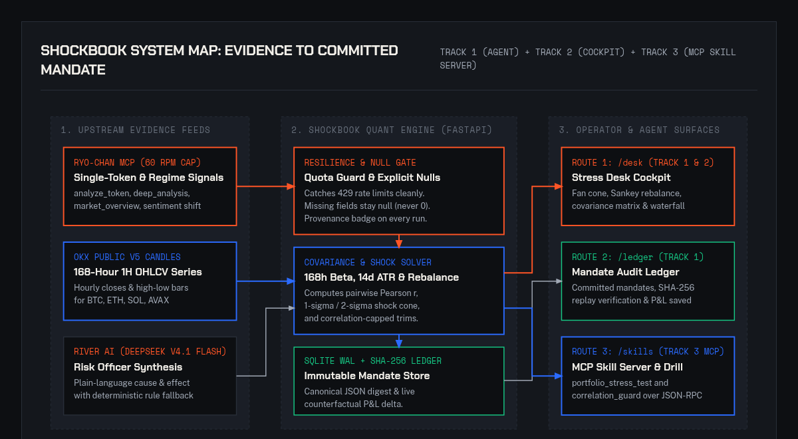
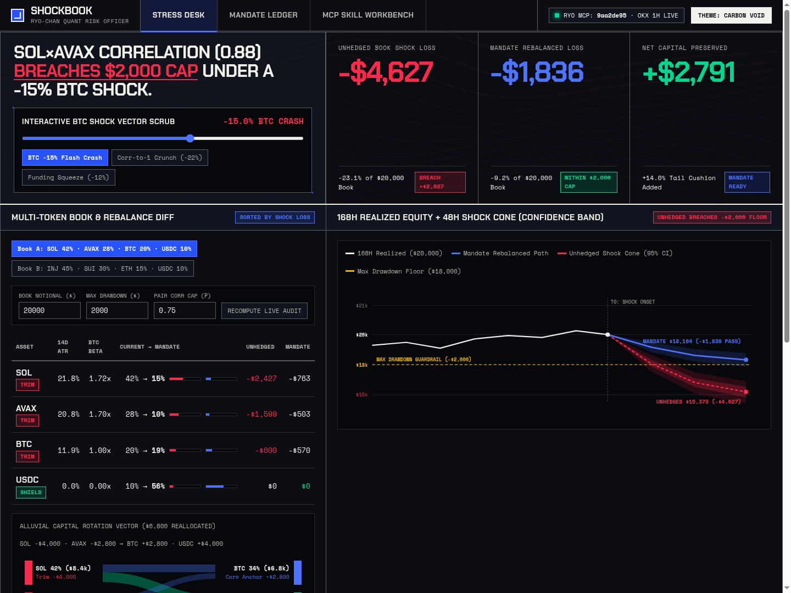
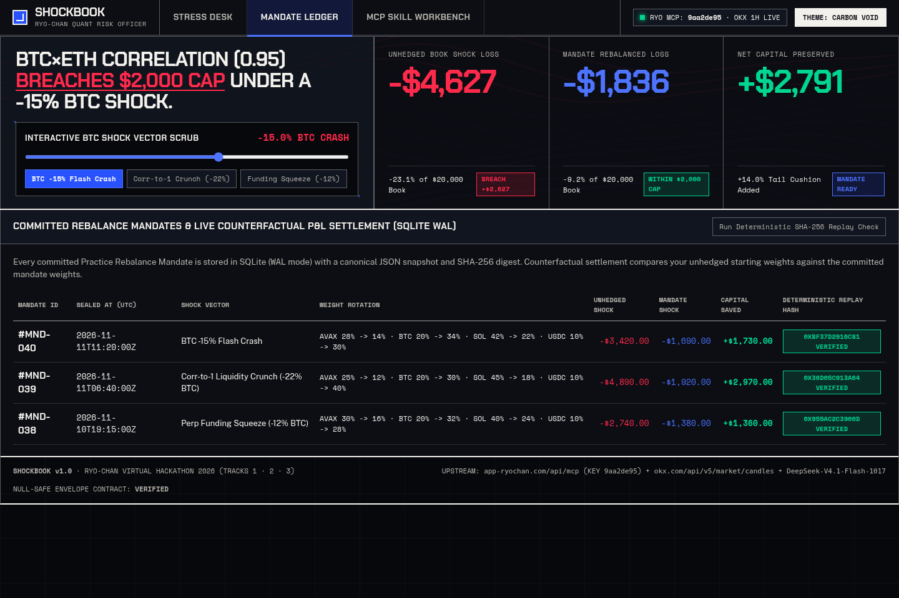
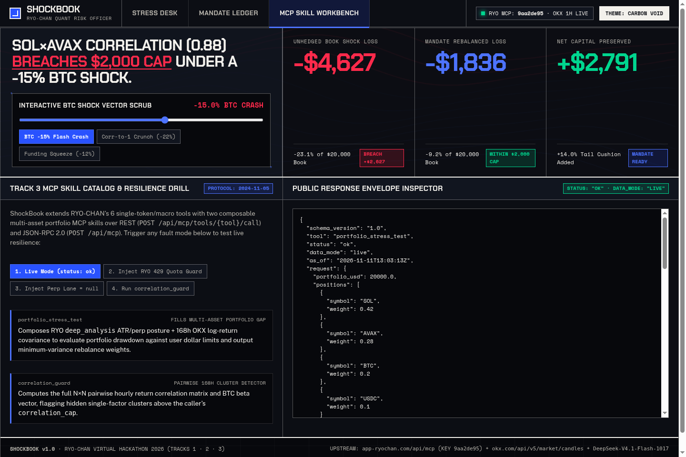
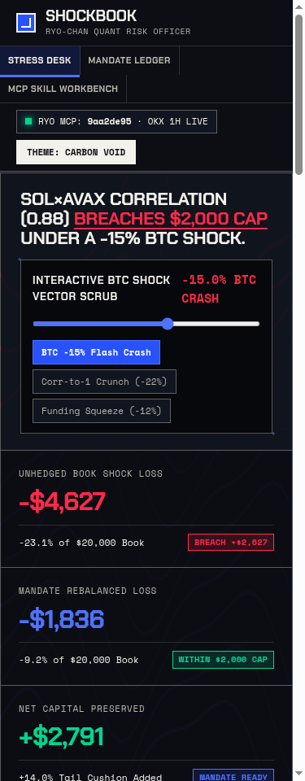

# ShockBook

**Quantitative Crypto Portfolio Stress-Test Engine, Correlation-Capped Rebalance Desk, and MCP Risk Skill Server**

[](https://shockbook.vercel.app)
[](https://youtu.be/BEyMHFRtVmY)
[](https://x.com/Pizzy_lee__/status/2120845234267476337)
[](https://shockbook.vercel.app/api/mcp/manifest)
[](./tests/test_shockbook.py)
[](./LICENSE)

**ShockBook** is a multi-token crypto portfolio risk and rebalance engine. It combines single-token market intelligence from RYO-CHAN (`market_overview`, `scan_market`, `analyze_token`, `deep_analysis`, `compare_tokens`, `monitor_market_sentiment_shift`) with 168-hour hourly OHLCV series from OKX V5 to expose hidden cross-asset tail risk, simulate market-wide liquidity shocks, and compute exact dollar rebalance trims before a drawdown hits.

- **Production Application:** [https://shockbook.vercel.app](https://shockbook.vercel.app)
- **Demo Video (YouTube):** [https://youtu.be/BEyMHFRtVmY](https://youtu.be/BEyMHFRtVmY)
- **X (Twitter) Post:** [https://x.com/Pizzy_lee__/status/2120845234267476337](https://x.com/Pizzy_lee__/status/2120845234267476337)
- **Stress Desk (`/desk`):** [https://shockbook.vercel.app/desk](https://shockbook.vercel.app/desk)
- **Mandate Ledger (`/ledger`):** [https://shockbook.vercel.app/ledger](https://shockbook.vercel.app/ledger)
- **MCP Skill Workbench (`/skills`):** [https://shockbook.vercel.app/skills](https://shockbook.vercel.app/skills)
- **MCP JSON-RPC Endpoint:** `POST https://shockbook.vercel.app/api/mcp/rpc`
- **MCP Tool Manifest:** `GET https://shockbook.vercel.app/api/mcp/manifest`

---

## The Problem It Solves

Token-level research tools evaluate assets in isolation or two at a time. A trader holding a multi-token book (for example `42% SOL`, `28% AVAX`, `20% BTC`, `10% USDC`) can see bullish single-token momentum scores on both `SOL` and `AVAX` while remaining blind to the fact that their 168-hour realized correlation has climbed to $r = 0.89$ with a combined `BTC` shock beta above $1.40$. When `BTC` drops `-18%`, those positions collapse together as a single leveraged bet.

ShockBook turns isolated token research into a portfolio-level risk mandate:

1. **Cross-Asset Covariance & Shock Simulation:** Pulls 168-hour `1H` candles across portfolio holdings, calculates the pairwise Pearson correlation matrix, empirical `BTC` beta ($\beta_i$), and 14-day Average True Range ($\text{ATR}_{14}$), and projects 24-hour portfolio equity across $1\sigma$ (68%) and $2\sigma$ (95%) confidence cones.
2. **Correlation-Capped Rebalance Solver:** When projected portfolio loss breaches the operator's dollar drawdown ceiling (`max_drawdown_usd`) or pairwise correlation exceeds `correlation_cap`, the solver calculates exact dollar trims on the highest-drawdown correlated legs and routes the proceeds into `USDC` reserve.
3. **Immutable SQLite WAL Mandate Ledger:** Commits approved rebalance mandates to a write-ahead-logged SQLite store with canonical JSON serialization, `SHA-256` deterministic replay verification, and live counterfactual P&L tracking (unhedged book vs. committed mandate).
4. **Native MCP Risk Skills (`portfolio_stress_test` & `correlation_guard`):** Exposes the quantitative engine over Model Context Protocol (JSON-RPC `2024-11-05` and REST) with a sliding-window `60 RPM` quota guard, cached fallback under upstream rate limits, and strict `null` preservation for missing upstream fields.

---

## System Architecture



*Self-contained HTML/SVG diagram source: [`docs/diagrams/architecture.html`](./docs/diagrams/architecture.html)*

---

## Product Surfaces & Screenshots

### 1. Stress Desk (`/desk`)

The primary risk cockpit pairs a sticky shock-parameter rail with a 62%-viewport quantitative canvas:
- **Portfolio Shock Trajectory Cone:** Plots unhedged vs. post-mandate portfolio equity across a 24-hour shock horizon with $1\sigma$ and $2\sigma$ volatility bands.
- **Rebalance Mandate Flow (Sankey):** Visualizes exact dollar trims from over-correlated high-beta positions (`SOL`, `AVAX`) into the `USDC` reserve buffer.
- **168h Pairwise Correlation Matrix & Drawdown Waterfall:** Highlights correlation breaches ($r > 0.75$) and ranks token drawdown contributions from largest to smallest dollar impact.
- **Risk Officer Audit:** Generates plain-language cause-and-effect risk commentary via River AI (`deepseek-ai/DeepSeek-V4.1-Flash-1017`) with a deterministic rule fallback and inline definitions for quantitative metrics (`Beta`, `Covariance`, `ATR`, `Drawdown`).



---

### 2. Mandate Ledger & Counterfactual P&L (`/ledger`)

Every committed rebalance mandate is persisted in SQLite (`WAL` mode, `synchronous = NORMAL`, `foreign_keys = ON`) with a canonical JSON payload and a deterministic `SHA-256` digest:
- **Counterfactual P&L Tracking:** Tracks how the unhedged portfolio vs. the committed rebalance mandate performed against live market prices, quantifying exact dollar drawdown avoided.
- **Deterministic Replay Verification:** Clicking **Verify Replay Hash** recomputes the canonical `SHA-256` digest from stored weights, shock parameters, and covariance inputs to verify audit integrity.



---

### 3. MCP Skill Workbench & Resilience Drill (`/skills`)

Interactive workbench for testing and fault-drilling the two MCP skills (`portfolio_stress_test` and `correlation_guard`):
- **Live & Fault-Drill Execution:** Run live portfolio checks or inject simulated upstream faults (`429 Quota Guard`, `Upstream Timeout`, `Partial Null Token`) to verify graceful degradation.
- **Provenance & Null Envelope Inspector:** Inspects `status`, `degraded`, `cache_age_seconds`, `sources_used`, `missing_fields`, `confidence_penalty`, and `verification_hash` on every response.



---

### 4. Mobile Responsive Layout (`375px`)

Full parity across desktop (`1440px`) and mobile (`375px`) viewports without horizontal overflow or clipped controls:

<p align="center">
  
</p>

---

## Quantitative Methodology & Data Integrity

1. **168-Hour Hourly Returns & Pairwise Covariance:**
   For each asset $i \in \{\text{SOL}, \text{AVAX}, \text{BTC}, \text{ETH}\}$, ShockBook computes hourly returns $r_{i,t} = (P_{i,t} - P_{i,t-1}) / P_{i,t-1}$ over $T = 168$ hours and evaluates pairwise Pearson correlation:
   $$r_{i,j} = \frac{\sum_{t=1}^{T} (r_{i,t} - \bar{r}_i)(r_{j,t} - \bar{r}_j)}{\sqrt{\sum_{t=1}^{T} (r_{i,t} - \bar{r}_i)^2} \sqrt{\sum_{t=1}^{T} (r_{j,t} - \bar{r}_j)^2}}$$
2. **Shock Beta & Volatility Penalty:**
   Each token's empirical beta against `BTC` ($\beta_i = \text{Cov}(r_i, r_{\text{BTC}}) / \text{Var}(r_{\text{BTC}})$) is combined with its 14-day Average True Range ($\text{ATR}_{14}$) to project token-level drawdown under a user-selected `BTC` shock ($\Delta_{\text{BTC}} \in [-30\%, -5\%]$).
3. **Correlation-Capped Rebalance Solver:**
   When projected portfolio loss breaches `max_drawdown_usd` or pairwise correlation exceeds `correlation_cap`, the solver trims the highest-drawdown correlated legs in proportion to their excess risk contribution and routes those proceeds into `USDC` until the portfolio satisfies the mandate ceiling.
4. **Explicit Null Preservation (Never Zero-Filled):**
   If an upstream token feed returns `null` or times out (for example an unindexed token symbol), ShockBook preserves `price_usd: null`, `beta_btc: null`, `atr_pct: null`, and `shock_drawdown_usd: null`, records the path in `missing_fields`, increments `confidence_penalty`, and renders `N/A (upstream null)` in the UI instead of fabricating zeroes.

---

## MCP Skill Server API

### 1. Discover Tools (`GET /api/mcp/manifest` or JSON-RPC `tools/list`)

```bash
curl -s https://shockbook.vercel.app/api/mcp/manifest | jq .
```

### 2. Call `portfolio_stress_test` via JSON-RPC `2024-11-05` (`POST /api/mcp/rpc`)

```bash
curl -s -X POST https://shockbook.vercel.app/api/mcp/rpc \
  -H "Content-Type: application/json" \
  -d '{
    "jsonrpc": "2.0",
    "id": "stress-check-1",
    "method": "tools/call",
    "params": {
      "name": "portfolio_stress_test",
      "arguments": {
        "portfolio_usd": 50000,
        "shock_btc_pct": -18.0,
        "max_drawdown_usd": -4500,
        "correlation_cap": 0.75,
        "fault_mode": "live"
      }
    }
  }' | jq .
```

### 3. Call `correlation_guard` via REST (`POST /api/mcp/call`)

```bash
curl -s -X POST https://shockbook.vercel.app/api/mcp/call \
  -H "Content-Type: application/json" \
  -d '{
    "skill": "correlation_guard",
    "portfolio_usd": 50000,
    "shock_btc_pct": -18.0,
    "correlation_cap": 0.75,
    "fault_mode": "rate_limit_429"
  }' | jq .
```

---

## Repository Structure

```text
shockbook/
├── api/
│   └── index.py                # Vercel serverless ASGI entrypoint
├── backend/
│   ├── __init__.py
│   ├── db.py                   # SQLite WAL mandate ledger, canonical JSON, SHA-256 replay
│   ├── market_math.py          # 168h OKX candles, Pearson correlation, beta, ATR, shock cone
│   ├── mcp_server.py           # MCP skill server (REST + JSON-RPC 2024-11-05)
│   ├── risk_officer.py         # River AI (DeepSeek-V4.1-Flash-1017) audit synthesis + fallback
│   └── ryo_client.py           # RYO-CHAN MCP client with 60 RPM quota guard & null safety
├── design-system/
│   └── LEDGER.md               # Project design system ledger record
├── docs/
│   ├── diagrams/
│   │   └── architecture.html   # Self-contained HTML/SVG system architecture diagram
│   └── screenshots/            # Verified desktop (1440px) and mobile (375px) screenshots
├── static/
│   ├── app.js                  # Interactive SVG charts, Stress-Field shader, MCP fault drills
│   ├── fonts.css               # Self-hosted Chakra Petch, Public Sans, and Space Mono WOFF2
│   └── styles.css              # Architectural Chiaroscuro grid and dual-polarity themes
├── templates/
│   └── app.html                # Unified template for /desk, /ledger, and /skills
├── tests/
│   └── test_shockbook.py       # 8-test TDD verification suite (math, nulls, WAL, MCP, hygiene)
├── .env.example                # Environment variable template (no secrets committed)
├── DESIGN.md                   # Governing design system specification
├── LICENSE                     # MIT License
├── main.py                     # FastAPI application entrypoint
├── requirements.txt            # Python dependencies
└── vercel.json                 # Vercel serverless routing configuration
```

---

## Local Setup & Verification

### 1. Clone and Install Dependencies

```bash
git clone https://github.com/Pizzylee001/ShockBook.git
cd ShockBook
pip install -r requirements.txt
```

### 2. Configure Environment Variables

Copy `.env.example` to `.env` and populate your credentials:

```bash
cp .env.example .env
```

```ini
RYO_MCP_URL=https://app-ryochan.com/api/mcp
RYO_MCP_KEY=your_ryo_mcp_credential_here
RIVER_BASE_URL=https://api.river.ai/v1
RIVER_MODEL=deepseek-ai/DeepSeek-V4.1-Flash-1017
RIVER_API_KEY=your_river_api_key_here
PORT=8000
```

### 3. Run the Test Suite

```bash
pytest tests/test_shockbook.py -v
```

All 8 automated verification tests validate:
1. `test_market_math_covariance_and_shock`: 168h covariance matrix, beta, ATR, and rebalance mandate reduction.
2. `test_null_integrity_never_zero_fills`: Missing upstream token fields stay `None`/`null` and never become `0.0`.
3. `test_sqlite_wal_mandate_commit_and_deterministic_replay`: SQLite `WAL` persistence and `SHA-256` replay hash verification.
4. `test_track3_mcp_rest_and_jsonrpc_endpoints`: MCP JSON-RPC `2024-11-05` and REST fault-drill modes (`live`, `rate_limit_429`, `upstream_timeout`, `partial_null_token`).
5. `test_all_three_routes_render_and_link`: `/desk`, `/ledger`, and `/skills` return HTTP `200` with complete navigation.
6. `test_end_to_end_stress_and_mandate_http_workflow`: Full HTTP stress simulation, mandate commit, and hash verification.
7. `test_zero_em_dashes_across_codebase`: Enforces prose hygiene across templates, scripts, and backend modules.
8. `test_no_secrets_in_tracked_files`: Scans all git-tracked files to guarantee zero credential leaks.

### 4. Start the Local Server

```bash
uvicorn main:app --host 0.0.0.0 --port 8000
```

Open `http://localhost:8000/desk` in your browser.

---

## License

Released under the [MIT License](./LICENSE).
